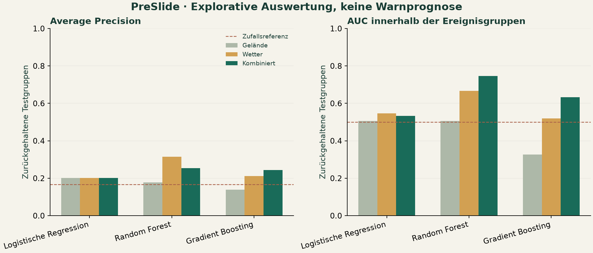
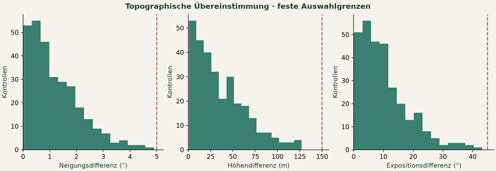

# Results — executed PreSlide V0 experiment

Run date: 2026-10-14. Dataset identity: `046074ba6f12556c`.

**60 of 102 candidate events completed, with 300 matched pseudo-negative controls (360 samples).** All retained samples have real pre-event terrain and guarded 60-day INCA histories. No synthetic research data.

## Exclusions

- insufficient_controls: 13 events
- missing_weather_values: 17 events
- implausible_weather_values: 9 events
- positive_dem_slope_below_minimum: 3 events

No quality threshold was relaxed after inspecting metrics. Negative precipitation is rejected rather than silently clipped. Weather-related exclusions can introduce selection bias by date and region.

## Frozen split

| Partition | Events | Dependence clusters | Samples |
|---|---:|---:|---:|
| test | 15 | 4 | 90 |
| train | 19 | 12 | 114 |
| validation | 26 | 4 | 156 |

Event groups, national 3-day episode clusters, nearby positives and overlapping sample patches remain intact. These clusters are conservative heuristics; residual geographic dependence remains.

## All planned model comparisons

| Model | Features | Test ROC AUC | Test AP | Within-group AUC | F1 |
|---|---|---:|---:|---:|---:|
| logistic_regression | static | 0.506 | 0.202 | 0.507 | 0.218 |
| logistic_regression | temporal | 0.535 | 0.201 | 0.547 | 0.205 |
| logistic_regression | combined | 0.517 | 0.202 | 0.533 | 0.148 |
| random_forest | static | 0.467 | 0.177 | 0.507 | 0.000 |
| random_forest | temporal | 0.601 | 0.314 | 0.667 | 0.000 |
| random_forest | combined | 0.615 | 0.253 | 0.747 | 0.000 |
| gradient_boosting | static | 0.388 | 0.139 | 0.327 | 0.000 |
| gradient_boosting | temporal | 0.524 | 0.212 | 0.520 | 0.121 |
| gradient_boosting | combined | 0.570 | 0.244 | 0.633 | 0.095 |

Chance ROC AUC and within-group AUC: 0.500. Chance AP: 0.167 for the fixed 1:5 design. Threshold is fixed at 0.5. Balanced classifiers are not calibrated population-risk estimators. Full precision/recall, balanced accuracy, confusion matrices, Brier scores, validation scores and cluster-bootstrap intervals are in `reports/experiment/metrics.json`.

## Temporal signal

- logistic_regression: combined minus static AP +0.000; within-group AUC +0.027.
- random_forest: combined minus static AP +0.076; within-group AUC +0.240.
- gradient_boosting: combined minus static AP +0.106; within-group AUC +0.307.

These are descriptive differences on one frozen split, not evidence of statistically established precursor detection. No model was selected or tuned using these test results. Temporal-only performance and within-group ranking are necessary checks: pooled AUC can benefit from between-event differences that do not distinguish local slopes.

## Geographic holdout

Held-out state: Steiermark; training events after dependence/border purging: 24; test events: 28.

| Model | Features | Geographic AP | Geographic within-group AUC |
|---|---|---:|---:|
| logistic_regression | static | 0.207 | 0.593 |
| logistic_regression | temporal | 0.235 | 0.650 |
| logistic_regression | combined | 0.230 | 0.643 |
| random_forest | static | 0.181 | 0.464 |
| random_forest | temporal | 0.202 | 0.436 |
| random_forest | combined | 0.179 | 0.450 |
| gradient_boosting | static | 0.159 | 0.386 |
| gradient_boosting | temporal | 0.210 | 0.529 |
| gradient_boosting | combined | 0.223 | 0.518 |

This is one state-level stress test, not proof of generalization across Austria.

## Matching and uncertainty

- distance_to_positive_m: median 6121.95; 95th percentile 9590.91; maximum 9957.78.
- slope_difference_deg: median 0.96; 95th percentile 3.08; maximum 4.90.
- elevation_difference_m: median 28.29; 95th percentile 92.29; maximum 127.14.
- aspect_difference_deg: median 8.54; 95th percentile 26.08; maximum 43.29.

Position diagnostic: 32 offsets within the source-category radius yield a median slope range of 5.7°. In 25 events a sampled offset changes slope by more than the 5° matching caliper. This is a deterministic sensitivity diagnostic, not a surveyed error model. Matching quality is conditional on the reported point.

## Provenance and deliverable boundary

© GeoSphere Austria. Detailed event source: Naturgefahren Test; specific reuse license not identified; QUAL_LAGE/QUAL_PROZ/QUAL_MB and timing interpretations not officially confirmed. Local non-commercial research was authorized by the user. Raw source snapshots and record-level tables are local and ignored; only aggregate results and a small derived demonstration are deliverables. See DATA_SOURCES.md, METHODOLOGY.md and LIMITATIONS.md.

## V0.2 development stability — separate experiment

Ein robuster zusätzlicher Wetternutzen ist nicht belegt. Baumverfahren verbessern teilweise die lokale Rangfolge, erreichen jedoch keine konsistente Verbesserung der Average Precision; die logistische Regression profitiert lokal nicht.

| Modell | Δ AP: Median [Min, Max] | Δ lokale AUC: Median [Min, Max] |
| --- | --- | --- |
| Logistische Regression | -0.023 [-0.037, +0.008]; 1/5 verbessert | -0.062 [-0.084, -0.009]; 0/5 verbessert |
| Random Forest | -0.001 [-0.016, +0.018]; 2/5 verbessert | +0.136 [-0.007, +0.169]; 4/5 verbessert |
| Gradient Boosting | -0.006 [-0.054, +0.007]; 1/5 verbessert | +0.040 [-0.082, +0.082]; 4/5 verbessert |

All 180 planned primary fits completed on 45 development events / 16 frozen clusters. Original test and Steiermark results above remain unchanged. See [complete V0.2 report](reports/stability_v02/summary.md).

## V0.3 null reference — separate exploratory analysis (2026-10-14)

Predeclared (`config/null_v03.json`), development cohort only, frozen V0.2 folds and unchanged models; 100 within-group label permutations. No variant containing weather features is distinguishable from the null (all p_upper ≥ 0.28). The V0.2 Random Forest local-ranking gain (+0.136, p = 0.04) reflects a terrain-only baseline below the null (0.416), not above-null weather performance. Null 90 % band for development within-group AUC ≈ 0.41–0.60, so only strong effects are detectable at this size. Original-test RF values (within-group AUC 0.747) are not reproduced in development and are best treated as chance-compatible. Full table: [reports/null_v03/summary.md](reports/null_v03/summary.md). Independent re-verification of all stored metrics: `reports/verification/independent_checks.json` (PASS).

## V0.4 — pre-registered extension with sealed external test (2026-10-14; separate version)

Full report generated from artifacts: `reports/v04/summary.md`. Verification: `scripts/verify_v04.py` → `reports/v04/verification.json` PASS. V0–V0.3 results above are unchanged.

**Data.** 500 tier-1 candidates with a narrative-confirmed day (2016–2026; no tier-A event before 2016 exists) in 48 temporal episodes → **423 complete groups (2 538 samples)**. Exclusions: 27 missing INCA values, 26 too few controls, 15 DEM slope < 5°, 9 negative precipitation. Spatio-temporal 50 km units were rejected by the pre-registered dependence check (90th percentile r = 0.64 ≥ 0.5); independence units are temporal episodes plus location links.

| Partition | Events | Independence units | Temporal episodes |
|---|---:|---:|---:|
| Development (all 60 baseline groups + same-storm events) | 123 | 19 | 24 |
| Sealed external test (baseline-free storms) | 300 | 11 | 12 |

Protocol amendment 1 (`reports/v04/AMENDMENT_1.json`, before any model): the registered rule linked groups through control–control overlaps and left a 4-event test; links and purge now use only positive-involving overlaps.

**Development (5 × 5 grouped CV, unit-weighted within-group AUC, median of repetitions):** static 0.770 (conditional logit), 0.762 (LR), 0.687 (GB); temporal 0.554 / 0.484 / 0.461; combined 0.725 / 0.725 / 0.630. Label-permutation 90 % band ≈ 0.35–0.64. Weather did not add to terrain in development (conditional logit static − combined +0.061 [−0.006, +0.150]).

**Sealed test, scored once** (11 units, 300 events):

| Model | Static | Temporal | Combined | Combined, per-event mean |
|---|---:|---:|---:|---:|
| Conditional logit (primary) | 0.702 | 0.604 | **0.751** [0.633–0.866] | 0.668 |
| Logistic regression | 0.702 | 0.667 | 0.719 | 0.639 |
| Gradient boosting | 0.580 | 0.622 | 0.616 | 0.627 |

Random-rank null (same weights): mean 0.50, 95 % quantile 0.629; primary p = 0.001. **Combined − static: +0.049 [−0.003, +0.108] — weather benefit not established.** Top-1 (combined) 0.373 vs chance 0.167.

Per unit (conditional logit): the Stanz storm 2016-07-25 (243 events) has static 0.455, temporal 0.574, combined 0.631; the next units (26 and 16 events) have static 0.815/0.850 and combined 0.846/0.812. The weighted result therefore rests on 11 units, several with 1–2 events, and the largest storm behaves differently. Breakdown: `reports/v04/test_by_unit_conditional_logit.json`.

The final conditional logit relies most on terrain roughness (+), forest cover (−), artificial/other land cover (+), TPI 150 m (−) and grassland (+); in the combined model also on recent rain features. This is predictive reliance, not causation; land-cover contrasts may partly reflect where events get reported.

## V0.5 — neighbour-slope ranking against ten unmatched controls (2026-10-14; separate version, exploratory)

Different question from V0–V0.4: the documented positive versus ten area-uniform, **unmatched** slope points 750 m–10 km around it. All 423 V0.4 positives were already seen, so this is a purged grouped CV, not a new test. Details and all numbers: `reports/v05/summary.md`, `reports/v05/cv_results.json`; verification `reports/v05/verification.json` (PASS).

- Cohort 418 groups / 4 598 samples / 29 V0.4 units (4 groups excluded for negative INCA values at a control, 1 technical terrain-check failure). All 418 recomputed positives equal their V0.4 features exactly.
- Primary (conditional logit, combined, spatially purged CV, unit-weighted local AUC): **0.851** (5 repetitions 0.835–0.863; bootstrap rep. 1 [0.762, 0.897]). Static 0.865, temporal 0.719; gradient boosting 0.798 / 0.794 / 0.658. Slope rule 0.572, chance 0.5. Top-1 0.413 (chance 0.091).
- **Combined − static: −0.023 [−0.079, +0.019]** (negative in all 5 repetitions): no weather benefit. Weather-only is above chance mainly because positives lie ~186 m lower than the background and INCA temperature/precipitation depend on elevation and location.
- Same cohort with the 5 original matched controls: 0.705 (static). The unmatched background is much easier to separate; the separation rests on elevation/position and land cover (forest 47 % vs 76 %), i.e. a mix of susceptibility and reporting probability.
