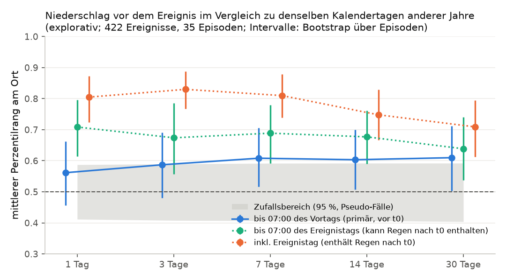
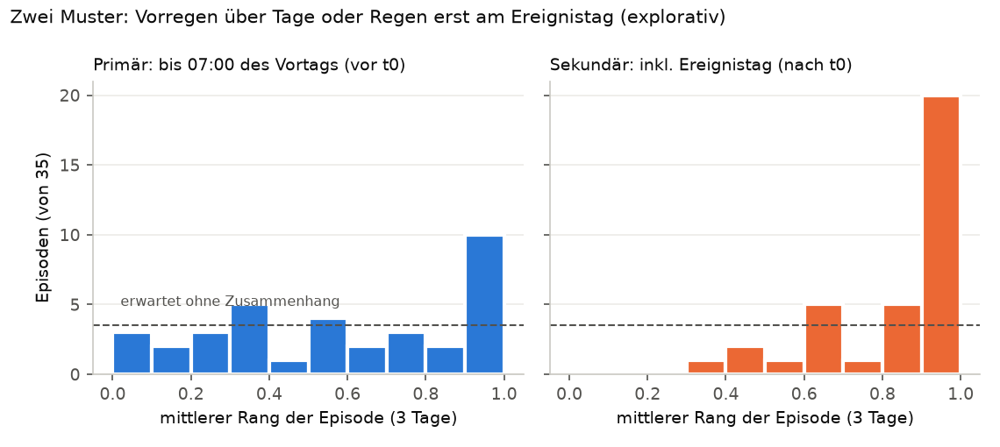
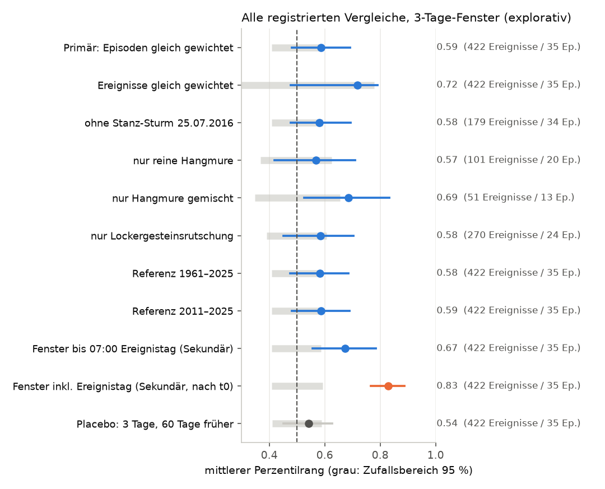

# Extremwetter und dokumentierte Hangrutschungen am selben Ort

**extremwetter_v01, Stand 18.10.2026. Explorativ.** Alle Ereignisse wurden schon in V0.4/V0.5 verwendet.
Das Ergebnis ist ein begründeter Hinweis, keine Bestätigung. Es zeigt einen Zusammenhang, keine Ursache.

## Kurzfassung

- **Frage:** War der Niederschlag vor einer dokumentierten Hangrutschung am Ereignisort extremer als an denselben
  Kalendertagen anderer Jahre, an denen dort nichts dokumentiert ist?
- **Daten:** 422 Ereignisse aus 35 unabhängigen Sturmepisoden. Tagesniederschlag GeoSphere SPARTACUS
  (1-km-Raster, seit 1961). Vergleich mit rund 1 050 Referenzfenstern je Ort aus 1991–2025.
- **Extreme Fenster sind deutlich häufiger als erwartet.** In **24,6 %** der Episoden lag der 3-Tage-Niederschlag vor
  dem Ereignis über dem örtlichen 95. Perzentil. Ohne Zusammenhang wären es 5 % (95-%-Intervall 11,8–38,2 %;
  p = 0,0002). Rechnerisch wurden nach solchen Fenstern etwa **6-mal so viele Ereignisse dokumentiert** wie nach
  anderen Fenstern derselben Jahreszeit (2,5–11,7).
- **Der vorab festgelegte Haupttest ist knapp nicht erfüllt.** Der mittlere Rang des 3-Tage-Fensters beträgt 0,587
  [0,481; 0,691]; ohne Zusammenhang wäre er 0,5 (p = 0,028). Das Intervall schließt 0,5 ein, daher gilt nach der
  registrierten Regel **„nicht belegt“**. Die 7-, 14- und 30-Tage-Fenster liegen knapp darüber (0,60–0,61).
- **Grund: zwei Muster.** Bei etwa einem Drittel der Episoden regnete es schon Tage vorher extrem, etwa beim Sturm
  „Boris“ im September 2024. Bei anderen fiel der Regen erst am Ereignistag, oft als Gewitter. Das strikt
  vorlaufende Fenster sieht diesen Regen nicht. Mit dem Ereignistag steigt der mittlere Rang auf 0,83. Dieses
  Fenster enthält aber Regen nach dem Ereignis und ist deshalb nur beschreibend.
- **Vorsicht:** Nach großen Unwettern werden Rutschungen vollständiger gemeldet. Dieser **Meldebias** kann einen
  Teil des Zusammenhangs erzeugen. Eine Bestätigung braucht neue Sturmepisoden; der Plan dafür ist vorab
  festgelegt (`CONFIRMATION_PLAN.md`).

## Warum diese Analyse nötig ist

V0.4 vergleicht den Rutschhang mit Nachbarhängen **am selben Tag**. Alle Hänge haben dort fast dasselbe Wetter.
Der Aufbau kann deshalb nicht zeigen, ob Extremwetter **mehr** Ereignisse auslöst. Er zeigt nur, welcher Hang bei
gegebenem Wetter betroffen ist. Hier wird umgekehrt gefragt: **derselbe Ort, verschiedene Tage**
(Case-Crossover). Gelände, Boden, Landbedeckung und Meldeinfrastruktur des Orts bleiben dabei gleich. Nur das
Wetter ändert sich.

## Vorgehen (vor der Berechnung registriert)

Registriert in `config/extremwetter_v01.json` (SHA-256 `98e33aa7…`, `REGISTRATION.json`), bevor ein Rang
berechnet wurde. Eine dokumentierte Änderung vor dem Volllauf (`AMENDMENT_1.json`) betrifft ein Ereignis, dessen
SPARTACUS-Zelle überhaupt keine Daten hat.

| Baustein | Festlegung |
|---|---|
| Kohorte | 423 Positive des eingefrorenen V0.4-Laufs (Datum Stufe A); 1 ohne SPARTACUS-Daten → **422 Ereignisse** |
| Unabhängige Einheit | zeitliche Episode (Ereignistage ≤ 3 Tage auseinander): **35 Episoden**. Der Stanz-Sturm vom 25.07.2016 allein umfasst 243 Ereignisse. |
| Wetter | GeoSphere SPARTACUS v2, Tagesniederschlag; nächste 1-km-Zelle (Abstand ≤ 681 m), 133 verschiedene Zellen |
| Exposition | Niederschlagssumme über 1, 3, 7, 14, 30 Tage; **Primär 3 Tage** |
| Fensterende (primär) | SPARTACUS-Tag = Ereignistag − 2, also Messung **bis 07:00 MEZ des Vortags**. Damit liegt alles sicher vor dem frühesten möglichen Ereigniszeitpunkt. |
| Sekundär | bis 07:00 des Ereignistags (kann Regen nach dem Ereignis enthalten); inkl. Ereignistag (enthält Regen nach dem Ereignis) |
| Referenz | derselbe Ort, ±15 Kalendertage in jedem Jahr 1991–2025 außer dem Ereignisjahr; Tage mit dokumentierter Rutschung ≤ 10 km und ±3 Tage ausgeschlossen (3,8 % der Referenztage) |
| Primärstatistik | Perzentilrang des Ereignisfensters in der Referenzverteilung desselben Orts (Gleichstände halb gezählt); ohne Zusammenhang im Mittel 0,5 |
| Zusatz | Anteil über dem örtlichen 95./99. Perzentil (erwartet ≈ 5 % / 1 %), daraus Case-Crossover-Ratenverhältnis |
| Gewichtung | jede Episode gleich (primär); jedes Ereignis gleich (Sensitivität) |
| Unsicherheit | 95-%-Intervall: Bootstrap über ganze Episoden (2 000 Ziehungen) |
| Nullreferenz | Pseudo-Fälle: Für jede Episode wird ein gemeinsamer Referenztag als „Fall“ gezogen und gegen die übrigen Referenzen gerankt (5 000 Ziehungen). Das erhält Sturmabhängigkeit und räumliche Korrelation. p = einseitig. |
| Aussage-Regel | „erhöht“ nur, wenn p < 0,05 **und** das Bootstrap-Intervall 0,5 ausschließt |

## Ergebnis 1: Haupttest – mittlerer Perzentilrang

Primäreinstellung: 422 Ereignisse, **35 Episoden**. Fenster enden um 07:00 des Vortags. Die Nullreferenz liegt
bei allen Fenstern bei 0,50; ihr 95-%-Bereich reicht etwa von 0,41 bis 0,59.

| Fenster | mittlerer Rang [95 %] | p (einseitig) | p nach Holm (5 Fenster) | Regel erfüllt? |
|---|---|---|---|---|
| 1 Tag | 0,562 [0,457; 0,663] | 0,081 | 0,081 | nein |
| **3 Tage (primär)** | **0,587 [0,481; 0,691]** | **0,028** | 0,057 | **nein** (Intervall enthält 0,5) |
| 7 Tage | 0,608 [0,516; 0,705] | 0,011 | 0,044 | ja (explorativ) |
| 14 Tage | 0,603 [0,507; 0,700] | 0,013 | 0,044 | ja (explorativ) |
| 30 Tage | 0,610 [0,503; 0,713] | 0,008 | 0,042 | ja (explorativ) |

Lesart: Im Mittel lag das Fenster vor einem Ereignis etwas nasser als ein typischer Tag derselben Jahreszeit am
selben Ort. Der Abstand ist jedoch klein. Ein mittlerer Rang von 0,6 bedeutet: Das Ereignisfenster war im Schnitt
nasser als 60 % der Vergleichsfenster.

## Ergebnis 2: Extreme Fenster sind stark überrepräsentiert

Hier gilt dieselbe Primäreinstellung (35 Episoden). „Erwartet“ ist der Anteil, der sich ohne Zusammenhang aus der
Referenz selbst ergibt.

| Fenster | über örtl. 95. Perz. [95 %] | erwartet | p | Ratenverhältnis [95 %] | über 99. Perz. | erwartet | p |
|---|---|---|---|---|---|---|---|
| 1 Tag | 17,3 % [6,5; 29,5] | 5,0 % | 0,003 | 4,0 [1,3; 8,0] | 9,2 % | 1,0 % | 0,0008 |
| **3 Tage** | **24,6 % [11,8; 38,2]** | 5,0 % | 0,0002 | **6,2 [2,5; 11,7]** | 8,2 % [1,0; 17,2] | 1,0 % | 0,002 |
| 7 Tage | 21,3 % [9,8; 34,0] | 5,0 % | 0,0002 | 5,1 [2,0; 9,7] | 8,4 % | 1,0 % | 0,003 |
| 14 Tage | 14,3 % [4,6; 25,1] | 5,0 % | 0,013 | 3,1 [0,9; 6,3] | 8,6 % | 1,0 % | 0,0008 |
| 30 Tage | 19,1 % [8,0; 31,9] | 5,0 % | 0,0006 | 4,5 [1,6; 8,9] | 8,2 % | 1,0 % | 0,002 |

p = 0,0002 ist der kleinste mit 5 000 Ziehungen erreichbare Wert. Das **Ratenverhältnis** ist die
Case-Crossover-Odds-Ratio. Sie beschreibt, wie viel mehr Ereignisse nach einem extrem nassen Fenster dokumentiert
wurden als nach anderen Fenstern derselben Jahreszeit am selben Ort. Sie ist keine Vorhersagewahrscheinlichkeit.
Die Intervalle sind breit, weil nur 35 Episoden vorliegen.

## Ergebnis 3: zwei Muster – Vorregen oder Regen am Ereignistag

Betrachtet man die 35 Episoden einzeln, zeigt das Primärfenster zwei Muster:

- **10 Episoden** liegen im obersten Zehntel (Rang ≥ 0,9). Dort fiel tagelang extrem viel Regen vor dem
  Ereignis. Beispiele sind Sturm „Boris“ im September 2024 (Median 116 mm in 3 Tagen) und August 2023
  (82 mm).
- **14 Episoden** liegen unter 0,5. Vor dem Ereignistag war es dort normal oder trocken. Beispiel: September 2018
  mit 0 mm in den drei Tagen davor und 26 mm im Messtag des Ereignistags.
- Mit dem Ereignistag (rechts) liegen **20 von 35 Episoden** im obersten Zehntel. Das passt zu kurzen, heftigen
  Gewittern, die das strikt vorlaufende Fenster nicht erfasst. Dieses Fenster enthält aber auch Regen **nach** dem
  Ereignis. Es zeigt nur, dass Ereignistage nass waren, nicht, dass der Regen vorher fiel.

Darum ist der *Mittelwert* nur mäßig erhöht, der *Anteil extremer* Fenster aber stark. Die Mittelwertregel war
vorab festgelegt und wird nicht nachträglich ersetzt. Der Befund zu extremen Fenstern ist als registrierte
Sekundäranalyse ebenfalls explorativ.

## Alle registrierten Vergleiche

Insgesamt gibt es **51 Vergleichszeilen**: 10 Einstellungen × 5 Fenster plus 1 Placebo. Jede Zeile enthält
mittleren Rang, 95.- und 99.-Perzentil-Anteil, Intervalle und p-Werte. Die vollständige Tabelle steht in
[`comparisons.md`](comparisons.md). Die Übersicht für das 3-Tage-Fenster:

| 3-Tage-Fenster | Ereignisse / Episoden | mittl. Rang [95 %] | p | über 95. Perz. [95 %] |
|---|---|---|---|---|
| Primär (Episoden gleich) | 422 / 35 | 0,587 [0,481; 0,691] | 0,028 | 24,6 % [11,8; 38,2] |
| Ereignisse gleich gewichtet | 422 / 35 | 0,717 [0,478; 0,790] | 0,118 | 15,6 % [3,0; 54,9] |
| ohne Stanz-Sturm | 179 / 34 | 0,581 [0,478; 0,694] | 0,039 | 25,3 % [12,2; 39,6] |
| nur reine Hangmure | 101 / 20 | 0,567 [0,420; 0,710] | 0,145 | 25,0 % [5,0; 45,0] |
| nur Hangmure gemischt | 51 / 13 | 0,686 [0,525; 0,832] | 0,009 | 32,1 % [7,7; 56,4] |
| nur Lockergesteinsrutschung | 270 / 24 | 0,584 [0,452; 0,704] | 0,066 | 24,6 % [9,0; 39,9] |
| Referenz 1961–2025 | 422 / 35 | 0,582 [0,476; 0,686] | 0,039 | 24,7 % [12,2; 38,2] |
| Referenz 2011–2025 | 422 / 35 | 0,587 [0,481; 0,690] | 0,025 | 24,9 % [12,1; 38,4] |
| bis 07:00 Ereignistag (kann nach t0 enthalten) | 422 / 35 | 0,674 [0,557; 0,785] | 0,0002 | 24,0 % [11,8; 37,8] |
| inkl. Ereignistag (enthält Regen nach t0) | 422 / 35 | 0,830 [0,767; 0,888] | 0,0002 | 31,9 % [18,4; 47,6] |
| **Placebo**: 3 Tage, 60 Tage früher | 422 / 35 | 0,542 [0,452; 0,627] | 0,19 | 6,5 % [0,9; 13,7] |

Was die Sensitivitäten zeigen:

- **Stanz-Sturm:** Ohne ihn ändert sich der Primärbefund kaum (0,581 statt 0,587). Bei gleicher Gewichtung aller
  Ereignisse dominiert er dagegen: 243 von 422 Ereignissen stammen aus diesem einen Gewitter vom Ereignistag, im
  Primärfenster mit Rang ≈ 0,79. Dann wird das Intervall sehr breit. Deshalb sind die Episoden die primäre Einheit.
- **Prozessklassen:** Alle drei Untergruppen zeigen beim Anteil extremer Fenster dieselbe Richtung (25–32 %). Die
  Untergruppen sind klein (13–24 Episoden). Unterschiede zwischen ihnen sind **nicht belegt**.
- **Referenzzeitraum:** Mit 1961–2025 oder nur 2011–2025 bleiben die Werte praktisch gleich. Ein Klimatrend in der
  Referenz erklärt den Befund also nicht.
- **Placebo:** Ein 3-Tage-Fenster 60 Tage vor dem Ereignis zeigt beim Anteil extremer Fenster nichts Auffälliges
  (6,5 % bei erwarteten 5 %). Der mittlere Rang ist mit 0,542 leicht, aber nicht signifikant erhöht. Ein kleiner
  Teil des mittleren Effekts kann daher von allgemein nasseren Jahreszeiten stammen. Der Extremanteil wird davon
  nicht erklärt.
- **Mehrfachvergleiche:** Von den 41 Zeilen ohne Regen nach dem Ereignis (inkl. Placebo) erfüllen 16 die
  Mittelwertregel. Beim 95.-Perzentil-Anteil liegt in 25 Zeilen die untere Intervallgrenze über dem
  Erwartungswert. Diese Zeilen sind stark voneinander abhängig (gleiche Ereignisse), also keine unabhängigen
  Bestätigungen.

## Einordnung: was das Ergebnis bedeutet und was nicht

1. **Explorativ, nicht bestätigt.** Die Ereignisse sind bekannt, und es wurden viele Varianten betrachtet. Erst
   ein Test an neuen Sturmepisoden nach `CONFIRMATION_PLAN.md` kann den Befund bestätigen.
2. **Zusammenhang, keine Ursache.** Die Analyse zeigt, dass dokumentierte Ereignisse auffällig oft auf extrem
   nasse Tage folgten. Dass Regen Hangrutschungen auslöst, ist physikalisch plausibel. Gemessen wird hier aber
   nur das gemeinsame Auftreten.
3. **Meldebias kann den Zusammenhang verstärken.** Nach großen Unwettern gibt es Kartierkampagnen, Medienberichte
   und Schadensmeldungen. Ereignisse an nassen Tagen werden darum wahrscheinlich vollständiger dokumentiert als
   einzelne Rutschungen an unauffälligen Tagen. Das Ratenverhältnis ist deshalb vermutlich eine Obergrenze. Die
   Daten können diesen Effekt nicht vom Wettereffekt trennen.
4. **Die Primärfenster sehen die letzten Stunden nicht.** Um sicher keine Information nach dem Ereignis zu
   verwenden, enden sie um 07:00 des Vortags. Gewitter am Ereignistag fehlen dort. Das unterschätzt den
   Wetterzusammenhang eher. Die Sekundärfenster schließen diese Lücke, enthalten aber Regen nach dem Ereignis.
5. **SPARTACUS beruht auf Stationsdaten.** Kleinräumige Gewitterzellen zwischen Stationen können fehlen oder
   geglättet sein. Ein 1-km-Rasterwert ist nicht der Regen am Hang.
6. **Referenztage sind nur „ohne dokumentiertes Ereignis“.** Ältere Rutschungen sind im Inventar unvollständig. Ein
   Referenztag kann also unbemerkt ein Ereignistag gewesen sein. Das schwächt den Kontrast eher ab.
7. **Effektive Stichprobe = 35 Episoden.** Jede Zahl oben ist eine Aussage über 35 Stürme, nicht über 422
   unabhängige Beobachtungen.

**Bezug zu V0.4:** V0.4 fand keinen belegten Zusatznutzen von Wetter, um *zwischen Nachbarhängen am selben Tag* zu
unterscheiden. Das widerspricht diesem Ergebnis nicht. Extremwetter bestimmt hier eher, *wann* Rutschungen
gehäuft dokumentiert werden. Welcher Hang dabei betroffen ist, hängt nach V0.4 vor allem von Gelände und
Landbedeckung ab.

## Nachvollziehbarkeit

- Code: `preslide/extremwetter/` (`python -m preslide.extremwetter pilot N | run | report`).
- Tests: `tests/test_extremwetter.py`, 55 Tests. Jeder Sicherheitstest scheiterte bei einem absichtlich
  eingebauten Fehler (`TEST_MUTATIONS.md`).
- Pilot 1 → 5 → 20 Ereignisse: Die Fallfenster wurden unabhängig aus den Rohantworten nachgerechnet und waren
  20/20 identisch. Ein zweiter identischer Lauf ergab eine bitgleiche `comparisons.json` (feste Seeds).
- Rohantworten liegen lokal mit Prüfsumme vor (`data/extremwetter_v01/cache/http`, 15 Anfragen). Ereignisbezogene
  Tabellen bleiben lokal. In diesem Ordner und im Web-Bündel stehen nur Aggregate.
- Eingefrorene Artefakte (V0.3-Baseline, V0.4, V0.5) wurden nur gelesen.
