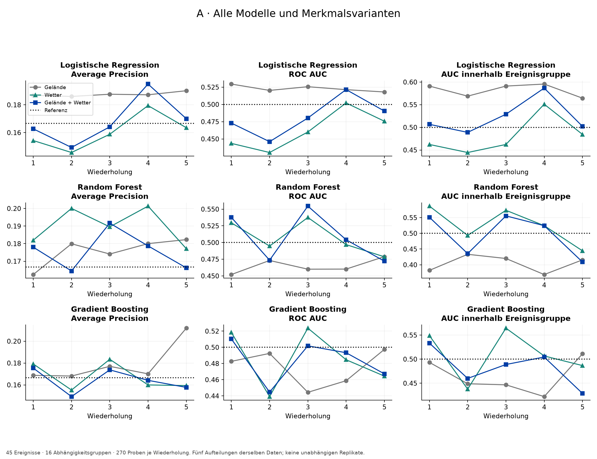
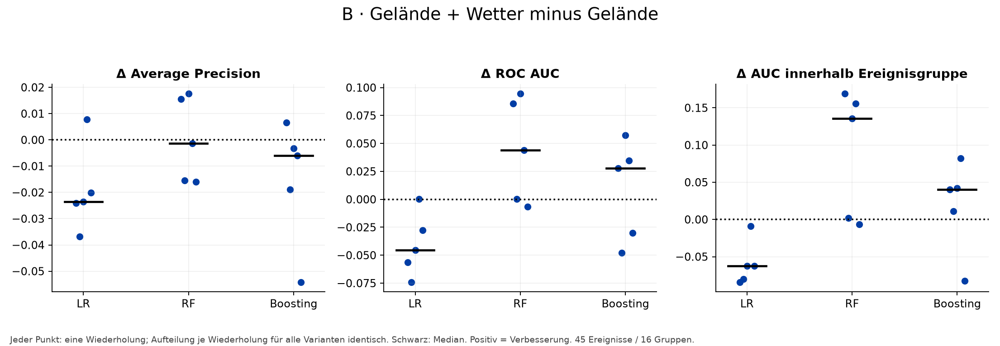
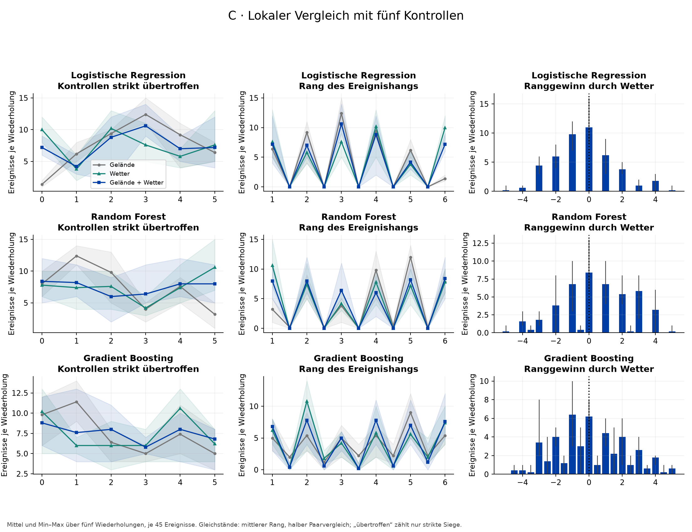
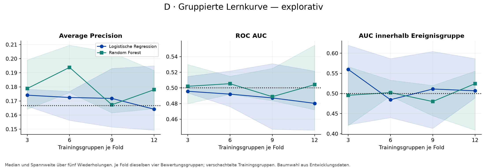
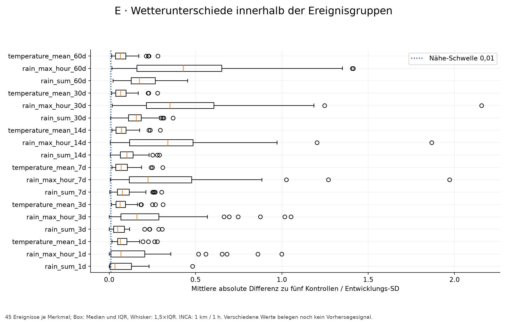
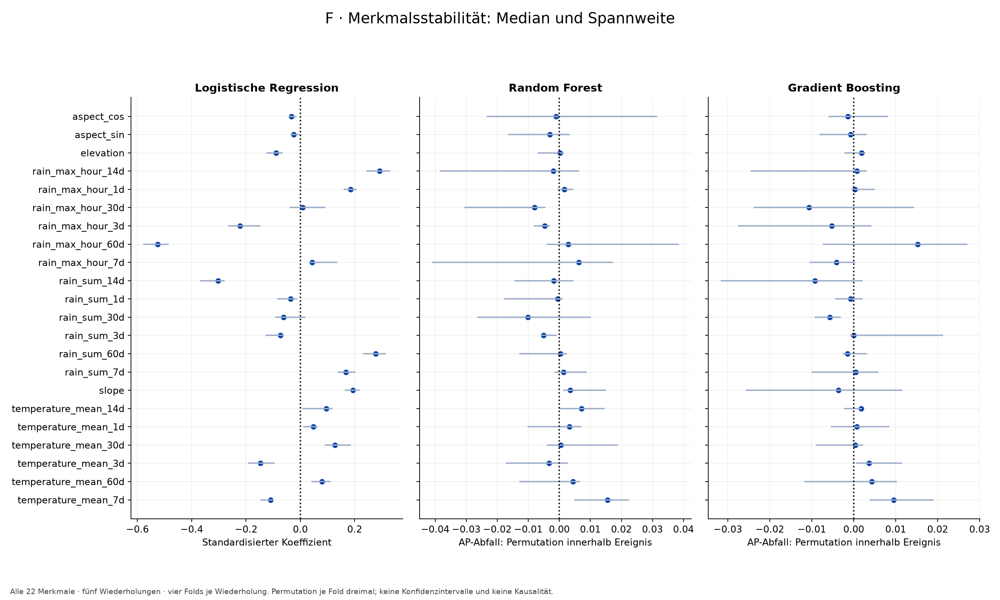
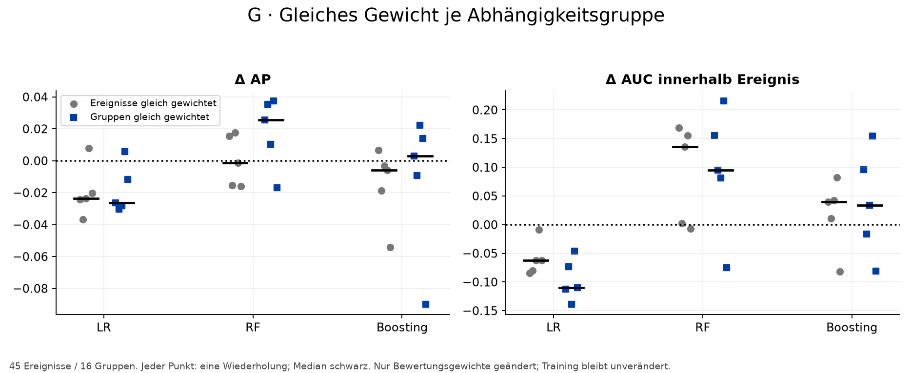

# PreSlide V0.2 — Stabilität und Signaldiagnose

**Ein robuster zusätzlicher Wetternutzen ist nicht belegt. Baumverfahren verbessern teilweise die lokale Rangfolge, erreichen jedoch keine konsistente Verbesserung der Average Precision; die logistische Regression profitiert lokal nicht.**

Entwicklungsanalyse, keine neue unabhängige Testbestätigung. 45 Ereignisse, 225 Pseudo-Negative, 270 Proben, 16 unverändert übernommene Abhängigkeitsgruppen. Ursprünglicher Test: 15 Ereignisse / 4 Gruppen, vollständig ausgeschlossen. Steiermark wurde nicht erneut bewertet; der autorisierte Entwicklungsbestand kann Steiermark-Ereignisse enthalten. Keine Auswahlentscheidung verwendet geografische Testergebnisse.

## Protokoll und Integrität

Der V0.1-Plan wurde im Chat „Build PreSlide V0 prototype“ (01a139ac-c4da-7380-b055-32d2cf32a148, Schlussantwort 01a139fb-4aa0-7a63-9e05-4f04fe41bedf) gefunden und vollständig gelesen. Er lag vorher nicht als Projektdatei vor. Seine Vorgaben und die V0.2-Diagnosen stehen vor dem ersten Training eingefroren in config/stability_v02.json. Seeds 11/23/37/51/71; vier Folds; unveränderte Modellparameter und Modellseed 42. Alle 180 Haupttrainings abgeschlossen; Pilot mit neun Varianten geprüft.

Kennzahlen je Wiederholung werden aus allen vier OOF-Vorhersagesätzen berechnet, nicht aus dem Mittel der Fold-APs. Alle Varianten nutzen identische Aufteilungen. Pooled OOF-Werte können zusätzlich durch unterschiedliche Score-Skalierung zwischen Folds beeinflusst sein; lokale Vergleiche nutzen stets dasselbe Modell. Schwelle 0,5 unverändert. Gleichstände: 0,5 Paarcredit, mittlerer Rang und anteilige Erstplatzierung. Strikt übertroffene Kontrollen zählen Gleichstände nicht als Sieg. Ranggewinn = Geländerang − kombinierter Rang.

Prüfsummen schützen Originaldatensatz, Matching, Modelle, Testvorhersagen und Berichte. Alle 270 Entwicklungs-Merkmalsvektoren wurden aus lokalen Original-Wetterantworten nachgerechnet; keine Abweichung. Keine Daten neu beschafft, keine Gruppen neu berechnet, keine Kontrollen entfernt. Raw-Cache-, CRS-, Datum-, Label- und Ausschlussprüfungen bestanden. Wissenschaftliche Restunsicherheiten bleiben bestehen.

## Die zehn wissenschaftlichen Fragen

### 1. Verbessert Wetter wiederholt die Leistung gegenüber Gelände?

Ein robuster zusätzlicher Wetternutzen ist nicht belegt. Baumverfahren verbessern teilweise die lokale Rangfolge, erreichen jedoch keine konsistente Verbesserung der Average Precision; die logistische Regression profitiert lokal nicht.

| Modell | Δ AP: Median [Min, Max] | Δ lokale AUC: Median [Min, Max] |
| --- | --- | --- |
| Logistische Regression | -0.023 [-0.037, +0.008]; 1/5 verbessert | -0.062 [-0.084, -0.009]; 0/5 verbessert |
| Random Forest | -0.001 [-0.016, +0.018]; 2/5 verbessert | +0.136 [-0.007, +0.169]; 4/5 verbessert |
| Gradient Boosting | -0.006 [-0.054, +0.007]; 1/5 verbessert | +0.040 [-0.082, +0.082]; 4/5 verbessert |

### 2. Ist ein Nutzen im lokalen Vergleich sichtbar?

Beim Random Forest beträgt die mediane lokale AUC-Differenz +0.136, mit Verbesserung in 4/5 Wiederholungen. 23/45 Ereignisse gewinnen in mindestens drei Wiederholungen Rangplätze, 15/45 verlieren. Bei LR verbessert sich die mittlere lokale AUC in 0/5 Wiederholungen. Ein einzelner konsistenter Nutzen für alle Ereignisse liegt nicht vor. Wichtig: Die RF-Baseline Gelände liegt bei einer medianen lokalen AUC von 0.416, das kombinierte Modell bei 0.524. Der positive Unterschied gegenüber einer schwachen Baseline belegt daher keine verlässliche Leistung oberhalb Zufall. Matching-Asymmetrie ist eine plausible, hier nicht bewiesene Erklärung.

### 3. Ist das Ergebnis über Gruppenaufteilungen stabil?

Nein als allgemeiner Wetternachweis: Modell, Metrik und Aufteilung liefern unterschiedliche Antworten. Die Intervalle der AP-Differenz und der lokalen AUC-Differenz überdecken für alle drei Modelle null. Der RF-ROC-AUC-Bootstrap liegt oberhalb null, ist aber eine explorative Auswertung gemittelter OOF-Scores mit fixierten Modellen; daraus folgt kein allgemeiner oder unabhängiger Validierungsnachweis.

| model | metric | lower_025 | upper_975 |
| --- | --- | --- | --- |
| gradient_boosting | average_precision | -0.0690 | 0.0072 |
| gradient_boosting | roc_auc | -0.0405 | 0.0770 |
| gradient_boosting | within_group_auc | -0.1001 | 0.0897 |
| logistic_regression | average_precision | -0.0614 | 0.0326 |
| logistic_regression | roc_auc | -0.1010 | 0.0009 |
| logistic_regression | within_group_auc | -0.2000 | 0.0500 |
| random_forest | average_precision | -0.0295 | 0.0873 |
| random_forest | roc_auc | 0.0067 | 0.1676 |
| random_forest | within_group_auc | -0.0118 | 0.2300 |

### 4. Sind die Wetterwerte innerhalb lokaler Gruppen ausreichend verschieden?

Es gibt messbare Variation: 0/225 Positiv-Kontroll-Paare nutzen dieselbe Rasterzelle; 0/45 Gruppen sind in allen 18 Merkmalen identisch. 0 Gruppen erfüllen das Nähe-Kriterium für mindestens 16 Merkmale. Das widerlegt eine allgemeine versehentliche Gleichsetzung der Wetterdaten, belegt aber keine ausreichende physikalische Auflösung auf Hangniveau. Ein 1-km-Produkt kann lokale Prozesse glätten.

### 5. Begrenzt die Datensatzgröße die Leistung?

Die Lernkurven zeigen keinen durchgehend steigenden Verlauf. Mehr Gruppen mit genau derselben Information garantieren daher keine Verbesserung. Mit nur 16 Abhängigkeitsgruppen bleibt die Schätzung unsicher; Stichprobenumfang, Diversität und Informationsgehalt lassen sich hier nicht trennen. Keine Hochrechnung einer zukünftigen AUC.

| model | fraction | average_precision | within_group_auc |
| --- | --- | --- | --- |
| logistic_regression | 0.2500 | 0.1741 | 0.5600 |
| logistic_regression | 0.5000 | 0.1725 | 0.4844 |
| logistic_regression | 0.7500 | 0.1718 | 0.5111 |
| logistic_regression | 1.0000 | 0.1642 | 0.5067 |
| random_forest | 0.2500 | 0.1788 | 0.4956 |
| random_forest | 0.5000 | 0.1938 | 0.5022 |
| random_forest | 0.7500 | 0.1673 | 0.4800 |
| random_forest | 1.0000 | 0.1780 | 0.5244 |

### 6. Dominieren wenige Stürme das Resultat?

Die größte Abhängigkeitsgruppe enthält 15/45 Ereignisse (33.3%). Das ist eine starke Gewichtskonzentration. Bei gleicher Gruppengewichtung beträgt der mediane RF-Wetternutzen Δ AP +0.025 und Δ lokale AUC +0.095. Der lokale RF-Nutzen verschwindet damit nicht vollständig; große Cluster allein erklären ihn nicht. Die Sensitivität ändert nur Bewertungsgewichte, nicht ihren Einfluss im Training. Gruppen sind keine meteorologisch bestätigten Sturmidentitäten.

### 7. Erklärt Matchingqualität einen Teil der scheinbaren Leistung?

Für LR korreliert schlechteres Matching mit besserem kombinierten Ereignisrang (Spearman ρ=-0.407, 45 Ereignisse / 16 Cluster). Das ist vereinbar mit ausnutzbaren Geländeunterschieden. Der Zusammenhang ist nicht bei allen Modellen gleich und beweist keinen Mechanismus. Alle Matchingmaße und Varianten wurden berichtet, keine Ereignisse entfernt.

### 8. Wirkt sich Positionsunsicherheit materiell aus?

Geländezuordnung ist empfindlich: 23/45 Ereignisse überschreiten bei den vorhandenen Positionsverschiebungen die 5°-Matchinggrenze. Die 100-m-Kategorie betrifft 19 Ereignisse; die präziseste Kategorie nur 5. Modellverhalten unterscheidet sich zwischen Kategorien, aber ein kausaler oder zuverlässig quantifizierter Leistungsverlust ist wegen kleiner, konfundierter Gruppen nicht bestimmbar.

### 9. Welche Merkmale sind wiederholt nützlich?

Merkmale mit innerhalb-Ereignis-Permutationsabfall >0,005 AP in mindestens vier Wiederholungen:

| model | feature | median | minimum | maximum | repetitions_above_005 |
| --- | --- | --- | --- | --- | --- |
| random_forest | temperature_mean_7d | 0.0155 | 0.0048 | 0.0225 | 4 |

LR mit in allen fünf Wiederholungen gleichem Koeffizientenvorzeichen:

| feature | median | minimum | maximum | sign_consistency |
| --- | --- | --- | --- | --- |
| rain_max_hour_60d | -0.5256 | -0.5783 | -0.4850 | 1.0000 |
| rain_sum_14d | -0.3030 | -0.3696 | -0.2784 | 1.0000 |
| rain_max_hour_3d | -0.2220 | -0.2661 | -0.1475 | 1.0000 |
| temperature_mean_3d | -0.1469 | -0.1920 | -0.0934 | 1.0000 |
| temperature_mean_7d | -0.1098 | -0.1465 | -0.0999 | 1.0000 |
| elevation | -0.0888 | -0.1255 | -0.0642 | 1.0000 |
| rain_sum_3d | -0.0731 | -0.1289 | -0.0607 | 1.0000 |
| rain_sum_1d | -0.0365 | -0.0845 | -0.0117 | 1.0000 |
| aspect_cos | -0.0325 | -0.0416 | -0.0141 | 1.0000 |
| aspect_sin | -0.0243 | -0.0359 | -0.0033 | 1.0000 |
| rain_max_hour_7d | 0.0432 | 0.0359 | 0.1364 | 1.0000 |
| temperature_mean_1d | 0.0486 | 0.0107 | 0.0643 | 1.0000 |
| temperature_mean_60d | 0.0795 | 0.0402 | 0.1107 | 1.0000 |
| temperature_mean_14d | 0.0955 | 0.0081 | 0.1189 | 1.0000 |
| temperature_mean_30d | 0.1272 | 0.0895 | 0.1858 | 1.0000 |
| rain_sum_7d | 0.1677 | 0.1380 | 0.2040 | 1.0000 |
| rain_max_hour_1d | 0.1848 | 0.1589 | 0.2083 | 1.0000 |
| slope | 0.1942 | 0.1639 | 0.2184 | 1.0000 |
| rain_sum_60d | 0.2775 | 0.2296 | 0.3149 | 1.0000 |
| rain_max_hour_14d | 0.2917 | 0.2432 | 0.3311 | 1.0000 |

Alle Merkmale stehen in feature_stability.csv. Vorzeichenstabilität bedeutet weder positiven Vorhersagenutzen noch Kausalität. Kumulierte Wetterfenster sind korreliert; schwache Modellleistung begrenzt die Interpretierbarkeit.

### 10. Was ist die stärkste wissenschaftlich tragfähige Aussage?

Im festgelegten österreichischen Entwicklungsbestand liefern die vorhandenen Wettermerkmale modellabhängige Hinweise auf veränderte lokale Rangfolgen. Ein stabiler zusätzlicher Vorhersagenutzen über Gelände hinaus und eine Übertragbarkeit auf unabhängige Ereignisse sind nicht nachgewiesen. Dieser Befund beweist weder die Abwesenheit physikalischer Vorläufersignale noch die Unbrauchbarkeit von Wetterdaten.

## Genau eine nächste Forschungspriorität

**Zusätzliche unabhängige Wetter- und Ereignisepisoden mit verifizierten Ereignispositionen als vorab festgelegten externen Prüfbestand gewinnen.**

Begründung: modellabhängiges Signal, nicht monoton steigende Lernkurven und starke Konzentration auf wenige Abhängigkeitsgruppen. Ziel ist zunächst eine belastbarere unabhängige Prüfung; ein höherer Messwert durch zusätzliche Daten wird nicht versprochen. Die bisherigen Entwicklungs- und Testdaten bleiben dafür beobachtete historische Experimente.

## Vollständige Ergebnisse und Zusatzdiagnosen

### Feste Wetterfenster und Interaktionen (explorativ)

Alle Fenster wurden mit logistischer Regression auf denselben Aufteilungen geprüft. immediate = 1/3 Tage, short = 7/14 Tage, antecedent = 30/60 Tage, full = alle Fenster. Die Fenster sind kumulativ und überlappen; die Tabelle erlaubt keine isolierte kausale Zuordnung zu einem Zeitraum. Medianwerte über fünf Wiederholungen:

| features | window | average_precision | within_group_auc |
| --- | --- | --- | --- |
| combined | antecedent | 0.1803 | 0.4933 |
| combined | full | 0.1642 | 0.5067 |
| combined | immediate | 0.1788 | 0.5556 |
| combined | short | 0.1725 | 0.5467 |
| temporal | antecedent | 0.1828 | 0.4622 |
| temporal | full | 0.1588 | 0.4622 |
| temporal | immediate | 0.1729 | 0.5200 |
| temporal | short | 0.1673 | 0.5689 |

Kein Fenster wird nach diesen Ergebnissen zum neuen Hauptmodell erklärt. Die drei festgelegten Wetter-Gelände-Produkte verändern die LR-Ergebnisse wie folgt:

| features | average_precision | within_group_auc |
| --- | --- | --- |
| combined | 0.1642 | 0.5067 |
| combined_interactions | 0.1710 | 0.4844 |
| static | 0.1872 | 0.5911 |

Die Interaktionen erhöhen die mediane AP geringfügig, verschlechtern jedoch die lokale Rangfolge. Das ist kein konsistenter Leistungsgewinn und begründet keine zusätzliche Suche nach günstigen Interaktionen. Alle Wiederholungen bleiben in den zugehörigen CSV-Dateien dokumentiert.

| repetition | model | features | average_precision | roc_auc | within_group_auc | positive_rank | top1_fractional |
| --- | --- | --- | --- | --- | --- | --- | --- |
| 1 | gradient_boosting | combined | 0.1754 | 0.5104 | 0.5333 | 3.3333 | 0.1889 |
| 1 | gradient_boosting | static | 0.1687 | 0.4827 | 0.4933 | 3.5333 | 0.1370 |
| 1 | gradient_boosting | temporal | 0.1792 | 0.5184 | 0.5489 | 3.2556 | 0.1156 |
| 1 | logistic_regression | combined | 0.1627 | 0.4730 | 0.5067 | 3.4667 | 0.0889 |
| 1 | logistic_regression | static | 0.1869 | 0.5295 | 0.5911 | 3.0444 | 0.1111 |
| 1 | logistic_regression | temporal | 0.1543 | 0.4436 | 0.4622 | 3.6889 | 0.1111 |
| 1 | random_forest | combined | 0.1780 | 0.5377 | 0.5511 | 3.2444 | 0.1778 |
| 1 | random_forest | static | 0.1624 | 0.4520 | 0.3822 | 4.0889 | 0.0556 |
| 1 | random_forest | temporal | 0.1820 | 0.5296 | 0.5867 | 3.0667 | 0.3333 |
| 2 | gradient_boosting | combined | 0.1493 | 0.4447 | 0.4600 | 3.7000 | 0.1778 |
| 2 | gradient_boosting | static | 0.1681 | 0.4925 | 0.4489 | 3.7556 | 0.1370 |
| 2 | gradient_boosting | temporal | 0.1553 | 0.4391 | 0.4378 | 3.8111 | 0.1889 |
| 2 | logistic_regression | combined | 0.1493 | 0.4460 | 0.4889 | 3.5556 | 0.1333 |
| 2 | logistic_regression | static | 0.1860 | 0.5203 | 0.5689 | 3.1556 | 0.1333 |
| 2 | logistic_regression | temporal | 0.1457 | 0.4303 | 0.4444 | 3.7778 | 0.1333 |
| 2 | random_forest | combined | 0.1645 | 0.4736 | 0.4356 | 3.8222 | 0.1556 |
| 2 | random_forest | static | 0.1799 | 0.4731 | 0.4333 | 3.8333 | 0.0889 |
| 2 | random_forest | temporal | 0.2000 | 0.4947 | 0.4933 | 3.5333 | 0.1778 |
| 3 | gradient_boosting | combined | 0.1738 | 0.5018 | 0.4889 | 3.5556 | 0.1556 |
| 3 | gradient_boosting | static | 0.1770 | 0.4444 | 0.4467 | 3.7667 | 0.0889 |
| 3 | gradient_boosting | temporal | 0.1834 | 0.5237 | 0.5644 | 3.1778 | 0.1556 |
| 3 | logistic_regression | combined | 0.1642 | 0.4803 | 0.5289 | 3.3556 | 0.1556 |
| 3 | logistic_regression | static | 0.1876 | 0.5256 | 0.5911 | 3.0444 | 0.1556 |
| 3 | logistic_regression | temporal | 0.1588 | 0.4600 | 0.4622 | 3.6889 | 0.1556 |
| 3 | random_forest | combined | 0.1917 | 0.5546 | 0.5556 | 3.2222 | 0.2444 |
| 3 | random_forest | static | 0.1741 | 0.4601 | 0.4200 | 3.9000 | 0.0889 |
| 3 | random_forest | temporal | 0.1895 | 0.5376 | 0.5733 | 3.1333 | 0.2667 |
| 4 | gradient_boosting | combined | 0.1642 | 0.4933 | 0.5044 | 3.4778 | 0.1889 |
| 4 | gradient_boosting | static | 0.1701 | 0.4587 | 0.4222 | 3.8889 | 0.1370 |
| 4 | gradient_boosting | temporal | 0.1600 | 0.4846 | 0.5067 | 3.4667 | 0.1870 |
| 4 | logistic_regression | combined | 0.1950 | 0.5215 | 0.5867 | 3.0667 | 0.2667 |
| 4 | logistic_regression | static | 0.1872 | 0.5214 | 0.5956 | 3.0222 | 0.1333 |
| 4 | logistic_regression | temporal | 0.1795 | 0.5021 | 0.5511 | 3.2444 | 0.2889 |
| 4 | random_forest | combined | 0.1787 | 0.5042 | 0.5244 | 3.3778 | 0.2000 |
| 4 | random_forest | static | 0.1800 | 0.4602 | 0.3689 | 4.1556 | 0.0222 |
| 4 | random_forest | temporal | 0.2014 | 0.4969 | 0.5244 | 3.3778 | 0.2444 |
| 5 | gradient_boosting | combined | 0.1577 | 0.4672 | 0.4289 | 3.8556 | 0.0741 |
| 5 | gradient_boosting | static | 0.2120 | 0.4974 | 0.5111 | 3.4444 | 0.1926 |
| 5 | gradient_boosting | temporal | 0.1593 | 0.4644 | 0.4867 | 3.5667 | 0.1019 |
| 5 | logistic_regression | combined | 0.1700 | 0.4904 | 0.5022 | 3.4889 | 0.1556 |
| 5 | logistic_regression | static | 0.1902 | 0.5180 | 0.5644 | 3.1778 | 0.1778 |
| 5 | logistic_regression | temporal | 0.1635 | 0.4757 | 0.4844 | 3.5778 | 0.1556 |
| 5 | random_forest | combined | 0.1662 | 0.4721 | 0.4089 | 3.9556 | 0.1111 |
| 5 | random_forest | static | 0.1823 | 0.4789 | 0.4156 | 3.9222 | 0.1111 |
| 5 | random_forest | temporal | 0.1771 | 0.4786 | 0.4444 | 3.7778 | 0.1556 |

- [weather_distinguishability.md](weather_distinguishability.md)
- [exploratory_protocol.md](exploratory_protocol.md)
- [feature_stability.md](feature_stability.md)
- [storm_sensitivity.md](storm_sensitivity.md)
- [matching_diagnostics.md](matching_diagnostics.md)
- [position_uncertainty.md](position_uncertainty.md)

Alle vorgegebenen Fenster, Lernanteile, Interaktionen und Merkmale stehen in CSV-Dateien, auch bei ungünstigen Resultaten. Wiederholungen sind keine unabhängigen Studien. Bootstrap: 1.000 gepaarte Clusterziehungen gemittelter OOF-Scores, fixe Modelle, keine vollständige Trainingsunsicherheit. Kein Test der 20 Folds als unabhängige Beobachtungen. Keine Kausalbehauptung.

## Reproduktion und Datenzugriff

Mit vorhandenen lokalen Snapshots: `python -m preslide.stability --pilot`, `--primary`, `--diagnostics`; danach `python -m preslide.stability_analysis --base`, `--importance --pilot`, `--importance`, `--final`; `python -m preslide.stability_verify`. Gültige Fit- und Importance-Checkpoints werden wiederverwendet. Originaldaten nie mit einem neuen Pipeline-/Evaluation-Aufruf überschreiben.

Lokale Vorhersagen/Modelle/Trainings-IDs liegen unter data/analysis/stability_v02. Ereignisweise CSVs im Berichtsordner sind lokale Diagnoseartefakte und ausdrücklich von Paketen ausgeschlossen. Die Web-API stellt ausschließlich freigegebene Aggregatwerte und sieben feste Abbildungen bereit. Kein öffentliches Deployment.
